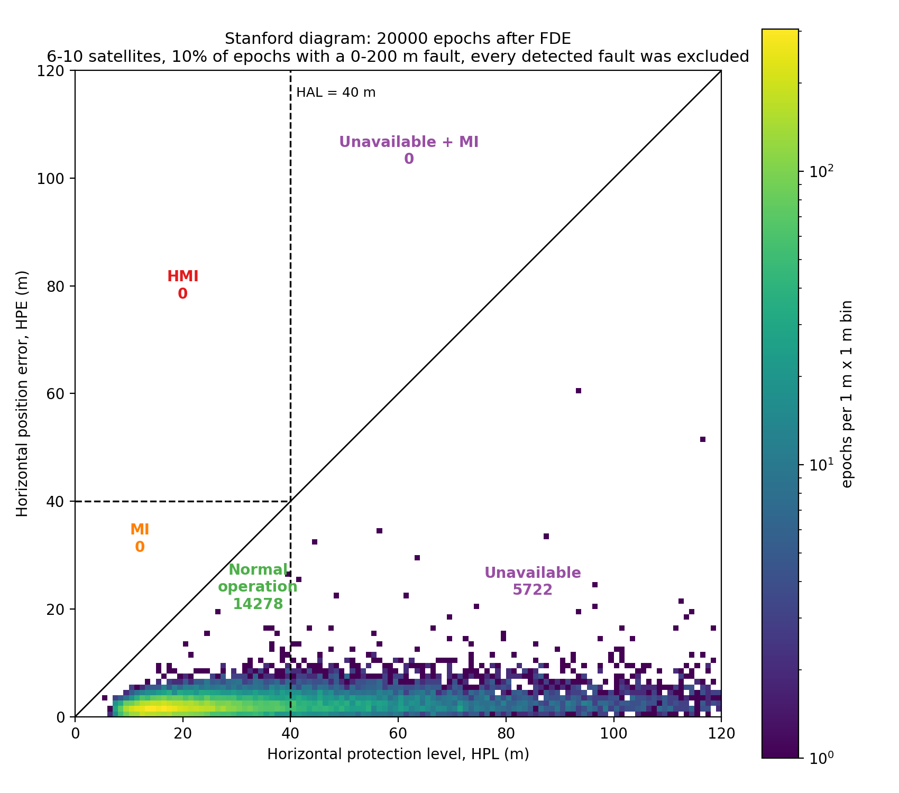
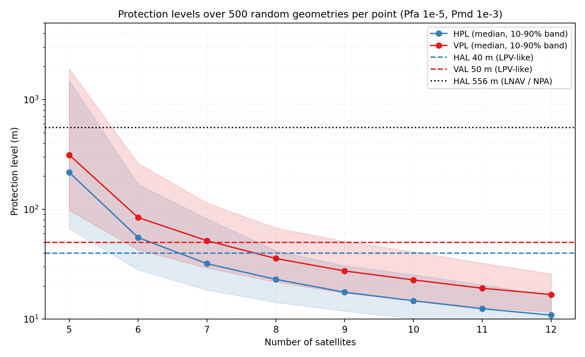

# gnss-integrity-raim

[](https://github.com/OrbitAR7/gnss-integrity-raim/actions/workflows/tests.yml)

A compact Python implementation of snapshot **Receiver Autonomous Integrity Monitoring (RAIM)**: weighted least-squares positioning, chi-square fault detection, fault exclusion, and slope-based horizontal and vertical protection levels. I wrote it to understand how integrity monitoring decides when a navigation solution should and should not be trusted.

## What it does

- Weighted least-squares position and clock from pseudoranges, with weights 1/σᵢ² from each satellite's error model
- **Fault detection:** chi-square test on WSSE = rᵀWr, threshold from Pfa
- **Fault exclusion:** removes the satellite with the largest normalized residual and re-tests until the solution passes or too few satellites remain
- **Protection levels:** separate horizontal and vertical slopes in the local ENU frame, with the bias size set by Pfa and Pmd (below)
- DOP in ENU, a Stanford-diagram classifier, and simulation helpers for geometry and fault injection

## Install

```bash
git clone https://github.com/OrbitAR7/gnss-integrity-raim.git
cd gnss-integrity-raim
pip install -e ".[plots,test]"
pytest
```

```python
import numpy as np
from gnss_raim import RAIM, RAIMConfig, create_satellite_geometry, simulate_pseudoranges

raim = RAIM(RAIMConfig(pfa=1e-5, pmd=1e-3))

rx = np.array([-742000.0, -5462000.0, 3198000.0])        # ECEF, m
geometry = create_satellite_geometry(rx, num_satellites=8, seed=1)
sats = simulate_pseudoranges(rx, geometry, noise_std=2.0,
                             fault_prn=3, fault_magnitude=50.0, seed=2)

result = raim.exclude_fault(sats)
print(result.status.value, f"HPL={result.hpl:.1f} m", "excluded:", result.excluded_prns)
# fault_excluded HPL=50.5 m excluded: [3]
```

`simulate_pseudoranges` stores the noise σ in each `Satellite.sigma`, and RAIM weights with it. With real data, `sigma` has to come from an error model of the receiver and signal; if it doesn't match the actual noise, the test statistic isn't chi-square and the false-alarm rate isn't Pfa.

## Protection levels

With n satellites and 4 unknowns, let A = (HᵀWH)⁻¹HᵀW and S = I − HA. A bias b on satellite i:

- moves the position by A₍:,i₎ b (rotated into East/North/Up)
- raises √WSSE by |b|·√(wᵢSᵢᵢ)

so the slopes, in metres of position error per unit of √WSSE, are

```
slope_H,i = ‖(A_E,i , A_N,i)‖ / √(wᵢ Sᵢᵢ)        slope_V,i = |A_U,i| / √(wᵢ Sᵢᵢ)
```

The detection threshold is T² = χ²⁻¹(1 − Pfa; n − 4). With a bias, WSSE follows a noncentral χ²(n − 4, λ). p_bias = √λ is chosen so that P(χ²(n − 4, λ) < T²) = Pmd, i.e. a bias that large is missed with probability Pmd. Then

```
HPL = max_i(slope_H,i) · p_bias        VPL = max_i(slope_V,i) · p_bias
```

This is the classic single-fault RAIM bound (Brown 1992). It doesn't add a term for the noise in the position solution itself. The tests check it directly: a bias on the worst satellite, sized so its mean horizontal error equals HPL, is missed in 135 of 3000 runs (4.5%) for Pmd = 5%, within the binomial spread (1σ ≈ 0.4%).

## Stanford diagram



20,000 epochs with random geometry (6-10 satellites, elevation-dependent σ = 1 m / sin(el)). 10% of epochs have a single-satellite fault of 0-200 m. Every epoch goes through fault detection and exclusion, and is plotted as its HPL against the true horizontal error. Regions, with PE = position error, PL = protection level, AL = alert limit:

| Region | Condition | Meaning | Count |
|---|---|---|---|
| Normal operation | PE ≤ PL ≤ AL | Bound holds, service available | 14,278 |
| Misleading information (MI) | PL < PE ≤ AL | Bound violated, error still inside the alert limit | 0 |
| Hazardously misleading information (HMI) | PL ≤ AL < PE | Service declared available, error beyond the alert limit | 0 |
| Unavailable | PE ≤ PL, PL > AL | PL too large to use the service | 5,722 |
| Unavailable + MI | PE > PL > AL | Bound violated while unavailable | 0 |

The largest HPE/HPL ratio in the run is 0.74. Zero MI in 20,000 epochs is expected because the bound is conservative. The rate it guarantees (about Pmd times the fault probability) is too small to show up in a run this size.

## Alert limits: LNAV vs. LPV

Snapshot RAIM (RTCA DO-208, TSO-C129a) was designed for en-route, terminal and LNAV/non-precision approach, where the alert limit is horizontal only: 0.3 NM = 556 m for LNAV. The 40 m HAL / 50 m VAL used in the figures are **LPV** limits. LPV is an SBAS service (RTCA DO-229), not something snapshot RAIM provides. I use those limits because they make the geometry effects visible. `RAIMConfig.lnav()` and `RAIMConfig.lpv_like()` set each pair.



Fraction of 500 random geometries per row where the protection level meets the limit (Pfa 1e-5, Pmd 1e-3, σ = 1 m / sin(el)):

| Satellites | median HPL (m) | HPL ≤ 556 m (LNAV) | HPL ≤ 40 m | HPL ≤ 40 m and VPL ≤ 50 m |
|---|---|---|---|---|
| 5 | 217 | 79% | 2% | 0% |
| 6 | 55 | 99% | 30% | 9% |
| 7 | 32 | 100% | 61% | 41% |
| 8 | 23 | 100% | 86% | 70% |
| 9 | 18 | 100% | 96% | 88% |
| 10 | 15 | 100% | 98% | 94% |
| 11 | 12 | 100% | 99% | 98% |
| 12 | 11 | 100% | 100% | 100% |

`python generate_readme_plots.py` regenerates both figures and this table.

## Tests

`pytest` runs 20 tests. They cover:

- a closed-form DOP case: one satellite at zenith plus n at equal azimuth spacing gives HDOP = 2/(cos(el)·√n)
- the geodetic/ENU frame
- noise-free positioning
- the false-alarm rate matching Pfa over 4000 epochs, with equal and with unequal σ
- detection of a 50 m bias
- the correct PRN being excluded
- p_bias reproducing Pmd exactly
- the missed-detection rate at the protection level
- the Stanford regions

## Examples

| Script | Shows |
|---|---|
| `examples/basic_raim.py` | Sky plot, residuals with and without a fault, detection sensitivity |
| `examples/fault_exclusion.py` | Step-by-step fault detection and exclusion |
| `examples/protection_analysis.py` | Protection levels vs. satellite count, geometry impact |

Each saves PNG files next to the script.

## Satellite requirements (snapshot RAIM, 4 unknowns)

| Satellites | Detection | Exclusion |
|---|---|---|
| 4 | No | No |
| 5 | Yes | No |
| 6+ | Yes | Yes |

## Limitations

This is a learning implementation, not certified avionics software:

- **Single fault only.** Exclusion removes the largest normalized residual instead of testing every subset, which can pick the wrong satellite in poor geometry.
- **Brown-style protection levels.** They have no explicit noise term and no integrity-risk allocation, unlike DO-229-style weighted RAIM.
- **Simulated measurements.** Geometry is a random sky (azimuth/elevation) projected onto the GPS orbit radius, not real ephemerides. Noise is Gaussian with a known σ. There's no multipath, no real receiver data and no multi-constellation.

The natural next step is **ARAIM**: multiple constellations (GPS + Galileo), solution separation over fault hypotheses including constellation-wide faults, and vertical guidance (Blanch et al.; EU-US ARAIM Working Group). It's also the integrity framework being studied for LEO-augmented PNT.

## References

- R. G. Brown, "A baseline GPS RAIM scheme and a note on the equivalence of three RAIM methods," *NAVIGATION* 39(3), 1992.
- RTCA DO-208, *MOPS for Airborne Supplemental Navigation Equipment Using GPS*, 1991, and FAA TSO-C129a: the basis for snapshot RAIM.
- RTCA DO-229, *MOPS for GPS/SBAS Airborne Equipment*: the SBAS equipment standard (LPV).
- T. Walter and P. Enge, "Weighted RAIM for precision approach," *ION GPS* 1995.
- J. Blanch, T. Walter, P. Enge et al., "Advanced RAIM user algorithm description," *ION GNSS* 2012, and later versions.

## License

MIT. See `LICENSE`.
